


 

  


  

 

## 👋 About me

AI Engineer with **~3.5 years** of hands-on work across **LLM, RAG and agentic systems** — from LoRA fine-tuning and REST integration to production multi-agent pipelines. I write reliable **Python backends** (FastAPI, PostgreSQL, Redis, Celery, Docker) with **multi-provider LLM routing and failover** (OpenAI, Claude, Gemini), cost control and automated tests.

I've delivered freelance GenAI projects for **healthcare, travel, education and SaaS** clients (including *Healines*, *SamaCapeTown* and *Erroz Technologies*), owning each one from requirements to release. Currently studying **B.Sc. Artificial Intelligence at Helwan University**.

| | |
|---|---|
| 🔭 **Now building** | A **full-duplex Arabic voice tutor** — Whisper STT → quantized 13B LLM → RAG → TTS, running locally *(freelance, in progress)* |
| 🧠 **Deep in** | LangGraph multi-agent pipelines · RAG · critic-led hallucination auditing · LoRA fine-tuning |
| 💸 **Obsessed with** | Cheap, reliable inference: 4-bit local models, cost-aware routing, budgets and failover |
| 🏗️ **I care about** | Systems that survive real users: guardrails, rate limiting, observability, regression tests |

## 🧰 Toolbox

 

## 🛣️ Experience

<b>⚡ AI Engineer (Freelance)</b> — Feb 2024 → Present · highlights

 

- Designed, built and deployed **production LLM, RAG and agentic automation** for clients in healthcare, travel, education and SaaS
- **Multi-agent workflows + RAG** with LangGraph, LangChain, ChromaDB, FAISS and Pinecone — tool calling, structured outputs, contradiction detection and critic-led hallucination audits
- **Cut inference cost and latency** with local 4-bit quantized models (Ollama, GGUF) and cost-aware multi-provider routing with automatic failover across OpenAI, Claude and Gemini
- **Containerised backends** — FastAPI, PostgreSQL, Redis with **atomic Lua token-bucket rate limiting**, Celery workers, JWT auth, Docker, deployed on Oracle Cloud
- **Real-time AI pipelines** — a local speech-to-speech tutor and a reusable WhatsApp agent SDK with persistent memory and human-in-the-loop controls
- Automated **regression testing for agents** (ReplayLens) plus E2E/API testing with Playwright and Bruno
- Worked directly with founders and non-technical stakeholders to turn business problems into technical specs

<b>🧪 LLM Engineer · Product MasterZ</b> — Apr 2023 → Dec 2023 · highlights

 

- Trained and adapted **specialised LLMs** for internal domains and business workflows in a cross-functional team
- Curated domain datasets, ran **LoRA fine-tuning** and prompt optimisation, and evaluated outputs for accuracy and task alignment
- Integrated fine-tuned models into the company backend via **REST APIs** for automated workflows
- Coordinated async sprints, dataset reviews and milestones with Trello, Notion and Slack

## 🚀 Featured projects

> Six repos, one thread: **take an LLM idea and make it reliable.** Click a card to open the repo.

<table>
<tr>
<td><a href="https://github.com/abdelrhmanHasaan/ResearchMultiAgentSystem">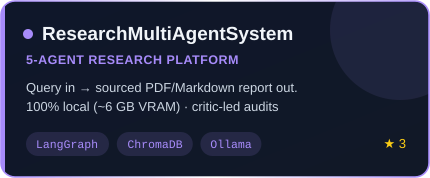</a></td>
<td><a href="https://github.com/abdelrhmanHasaan/SchemaForge.v2">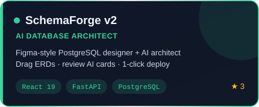</a></td>
</tr>
<tr>
<td><a href="https://github.com/abdelrhmanHasaan/wa-agent-sdk">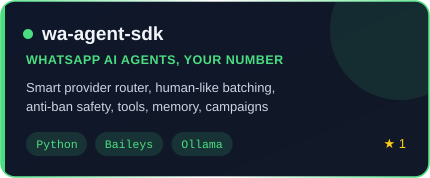</a></td>
<td><a href="https://github.com/abdelrhmanHasaan/JobFidner">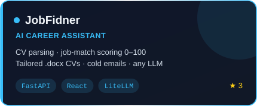</a></td>
</tr>
<tr>
<td><a href="https://github.com/abdelrhmanHasaan/DevMate">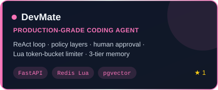</a></td>
<td><a href="https://github.com/abdelrhmanHasaan/ReplayLens">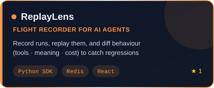</a></td>
</tr>
</table>

➕ Also built: an **Agentic Chatbot Template** — FastAPI + PostgreSQL + JWT with SSE streaming, tool execution and PDF parsing into structured outputs.

### 🎙️ In progress: Real-time Arabic AI voice tutor

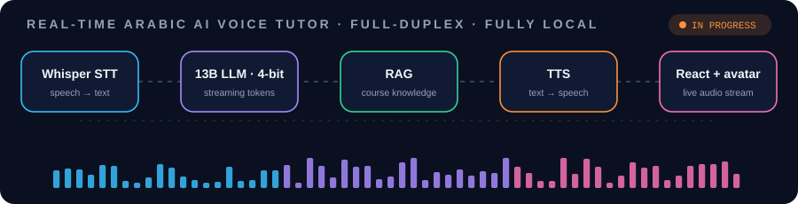

A full-duplex, fully local speech-to-speech tutor with streaming and session memory. STT, LLM, retrieval, TTS and UI are **decoupled services** so each can scale independently, with a React front-end that streams live audio to an AI avatar.

### 🧬 Inside my flagship: how the research agents think


Five agents turn a plain-language question into a **sourced Markdown/PDF report**. Source-credibility scoring and cross-document **contradiction detection** feed the Writer, and the **Critic** audits every draft for hallucinations, sending weak ones back with actionable feedback. It runs **fully local** — 4-bit Q4_K_M on about 6 GB of VRAM, Nomic embeddings + ChromaDB, Dockerised FastAPI services.

## 🔍 Project deep dives

<b>🕸️ ResearchMultiAgentSystem</b> — autonomous research platform (LangGraph · FastAPI · ChromaDB · Ollama)

 

- 🤖 **5-agent pipeline** with a Writer↔Critic revision loop (configurable score threshold & max loops)
- 🔀 **Two paths to intelligence** — hosted APIs (OpenRouter, Groq, OpenAI, Gemini) or **100% offline Ollama**
- 🛟 **Auto-fallback + runtime failover**, plus **per-stage routing** (strong writer, free local critic)
- 💰 **Cost ledger** — tokens, latency and estimated USD per call across 33+ priced models
- 📡 **Live progress over SSE**, source citations, report replay from history
- ✅ Layered architecture (`api → services → agents/tools`) with **50 offline tests**

<b>🗄️ SchemaForge v2</b> — Figma-style database designer with an AI architect

 

- 🖱️ Infinite **ERD canvas** — drag tables, draw relationships; PK→PK auto-creates a junction table
- 🤖 **SQLTRONE** AI architect streams reviewable **action cards** — it never touches your DB without approval
- ⚡ **One-click deploy** — idempotent DDL in a single transaction, then re-introspect so the ERD matches reality
- 🛠️ Monaco SQL editor, DDL preview, SQL import, **version history** with diffs, two-way sync
- ✅ **53 backend tests + 10 Playwright E2E** scenarios · OpenAI, Claude and Gemini supported

<b>💬 wa-agent-sdk</b> — WhatsApp AI agents on your own number

 

- 📱 Scan one QR → your agent is live. No Meta Business verification, no Cloud API
- 🧠 **Smart Provider Router** — scores query complexity, routes across fast/balanced/smart tiers with budgets, circuit breakers & failover (13 providers incl. local Ollama)
- 💬 **Human-like batching** — message bursts merge into one considered reply
- 🛡️ **Anti-ban toolkit** — rate limits, quiet hours, STOP compliance, humanised pacing
- 🧰 Tools, vision, documents, multi-persona routing, scheduler, campaigns

<b>🧭 JobFidner</b> — AI career assistant (FastAPI · React · LiteLLM)

 

- 📄 **CV parser** — PDF/DOCX → structured data + smart clarifying questions
- 🔍 **Job search + AI scoring** — every listing scored **0–100** against your CV, with missing keywords flagged
- 🎨 **One-click tailored CV** (`.docx`) and ✉️ **recruiter-email drafter** — the app never sends mail for you
- 💬 **Chat CV creator** using tool calling · 🔐 JWT in HttpOnly cookies, RBAC, GDPR export & delete, admin metrics
- 🔁 Provider-agnostic: swap OpenAI / Gemini / Anthropic / NVIDIA / OpenRouter with one `.env` line

<b>🛠️ DevMate</b> — production-grade agent template that doubles as a course

 

- ⏱️ **Redis token-bucket rate limiter** with atomic **Lua scripts** for race-free check-and-decrement — compared against an app-level version for atomicity & performance trade-offs
- 🔁 **ReAct loop** with step caps, wall-clock timeout and repeat-call guard
- 🛡️ **Defense in depth** — injection heuristics, PII scrubbing, shell allow-lists, secret redaction, path-jailed sandbox
- ✋ **Human-in-the-loop** approvals with diff previews · 🧠 short-term / long-term (pgvector) / episodic memory
- 🎓 **10 teaching modules**, each with its own README · FastAPI + React + Postgres + Redis via Docker Compose

<b>🎞️ ReplayLens</b> — regression testing for AI agent behaviour

 

- 🎥 `@trace` decorator records prompts, tool calls, latency & tokens — a **flight recorder** for agents
- ⏪ **Replay** past runs against a new prompt, model or temperature
- 🧮 **Behavioural diff engine** compares *tool usage*, *semantic meaning* and *cost/latency* instead of brittle string matches
- 🧰 Python SDK + FastAPI/Redis backend + React dashboard

## 🎓 Education, certificates & languages

| | |
|---|---|
| 🎓 **Education** | B.Sc. Artificial Intelligence — Helwan University, Faculty of AI, Cairo *(in progress)* · ML, Deep Learning, NLP, Computer Vision, DSA, Databases, Cloud, LLMs |
| 📜 **Certificates** | **IBM** AI/ML Professional Certificates (Machine Learning, Deep Learning, Generative AI, NLP) · **NVIDIA** AI Infrastructure & Operations Fundamentals |
| 🏆 **Competitions** | Nile University National Problem-Solving Competition (NCPC) — participant, 2024 |
| 🌍 **Languages** | Arabic (native) · English (written: professional, spoken: developing) |

## 📊 GitHub stats

<picture>
  <source media="(prefers-color-scheme: dark)" srcset="https://raw.githubusercontent.com/abdelrhmanHasaan/abdelrhmanHasaan/output/github-snake-dark.svg"/>
  
</picture>

 

*"Ship the model. Then make it boring — reliable, monitored, and cheap to run."*

**Open to freelance & full-time AI roles — [let's talk](mailto:abdelrhman14hassan@gmail.com) 👋**

